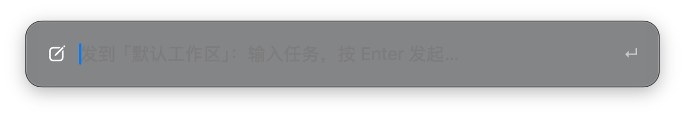

# dsh-status-box · 状态盒

**DeepSeek Harness 的状态盒**：菜单栏 / 任务栏常驻一条小鲸鱼看全局任务状态，按一下全局热键就能把任务丢进任意工作区——不用切回 DSH，也不用手动点开一个个工作区。macOS 与 Windows 共用同一套本机协议，插件侧不用改。

| 平台 | 状态图标 | 全局热键 | 说明 |
| --- | --- | --- | --- |
| **macOS** | 系统菜单栏（Objective-C 小助手） | `⌥⌘⇧D` | 已在 macOS 实机运行验证 |
| **Windows 10/11** | 任务栏托盘（.NET 8 WinForms） | `Ctrl+Alt+Shift+D` | 交叉编译通过、协议层冒烟测试通过；托盘/热键 UI 尚未在 Windows 实机跑过，欢迎反馈 |

> Status + quick task capture for DeepSeek Harness on macOS **and Windows**. A persistent menu-bar / tray whale shows running and waiting counts across workspace, and one global hotkey opens a Spotlight-style box that starts a real session in the workspace you pick.

> Status + quick task capture for DeepSeek Harness on macOS. A persistent menu-bar whale shows running / waiting / done counts across every workspace, and one global hotkey (`⌥⌘⇧D`) opens a Spotlight-style box that starts a real session in the workspace you pick.




## 它解决什么问题

在 DSH 里想知道"现在哪些会话在跑、哪个在等我"，得打开面板、一个个工作区点开；想发新任务，又得打开面板 → 找会话 → 输入。

状态盒把这两件事都搬到窗口外面：

- **看**：macOS 菜单栏常驻 `🐳 2`，颜色就是状态；点开菜单按工作区分组看明细。
- **发**：`⌥⌘⇧D` 弹出单输入框，敲需求 → Enter，任务在目标工作区新会话里立即开跑，**当前视图不动**。

## 组成

| 组件 | 位置 | 作用 |
| --- | --- | --- |
| 状态胶囊 | DSH 窗口顶部工作栏最左（会话标题左边） | `● 1 运行中`、`◉ 1 待处理`，点一下直接召唤原生输入窗 |
| 菜单栏图标 | macOS 顶部系统菜单栏（Wi‑Fi 那一排） | **DeepSeek 小鲸鱼** + 数字，鲸鱼和数字一起随状态变色；菜单里看按工作区分组的会话 |
| 原生悬浮窗 + 全局快捷键 | 鼠标所在屏幕居中偏上（`⌥⌘⇧D`） | **只有一个输入框**（Spotlight 风格）：敲需求 → Enter 直接发起；不依赖 DSH 是否开着；**发失败会自己弹回来，原文保留、红字写明原因，回车重试** |
| 配置页 | DSH → 设置 → **状态盒** | 一个开关：发送后**打开对话页**，还是**留在原地**继续手头的事 |

状态含义：

- `◉` 橙色 = 有会话在**等你**（审批 / 提问 / 计划确认）
- `●` 绿色 = 有会话**正在运行**
- `✓` 蓝色 = 有会话刚完成（未读）
- `○` 灰色 = 空闲，或 DSH 已退出（90 秒无心跳）

## 使用

- **看状态**：DSH 开着时看顶部工作栏胶囊；最小化或切到别的 App 时看菜单栏小鲸鱼。
- **看详情**：点菜单栏图标 → 菜单里按工作区分组显示 `名称 · N 待 · N 运行`，下面是最近会话列表。
- **召唤**：按 **⌥⌘⇧D**（全局，任何 App 前台都生效）→ 弹出原生悬浮窗，光标已在输入框：
  - **按一次弹出，再按一次收起**（toggle）；窗口出现在鼠标所在屏幕的居中偏上
  - 输入框只有一条提示：`发到「工作区名」：输入任务，按 Enter 发起…`；按 **Tab** 切换目标工作区（记住上次选择）
  - 敲需求 → **Enter** 直接发起，窗口立即收起；**Esc** 取消；点窗口外面也会收起
  - 备用快捷键 **⌥⌘⇧K**：个别 Mac 上 `⌥⌘⇧D` 会被别的 App 的全局键盘钩子吞掉，这时按 K 一样能用
  - **DSH 关着也能用**：任务先入队，DSH 启动后 2 秒内自动发出
  - Carbon 全局热键，不需要辅助功能授权，也不会因为 DSH 不运行而失效
- **窗口内不再有面板**：只留一个小胶囊显示汇总状态。DSH 内部的 `⌘⇧K` 等于「召唤原生输入窗」，点胶囊也是同一个动作。
- **发失败会自己弹回来**：任务投递失败（比如 DSH 里没有可用的会话服务）时，输入框会重新弹出、文字保留并选中，右上角红字写明原因（如 `发送失败（noService）`），回车即可重试；不会再"静默消失"。
- **配置页**：DSH → 设置 → **状态盒**，一个开关「发送后打开对话页」：
  - **开**：悬浮窗里发完，DSH 被拉到前台，并直接打开这个新会话（看它跑）。
  - **关**（默认）：任务照样在目标工作区开跑，但**不抢你的窗口**，你继续忙手头的事。
  - 开关只在这个配置页里（菜单栏菜单是纯功能菜单，不放配置项）；配置写在 `~/Library/Application Support/DSHStatusBox/config.json`。

## 安装

### 一键装（推荐）

1. 在 DSH 插件市场里装 **dsh-status-box**（或把本仓库作为 bundle 装进 profile）。
2. 打开 **DSH → 设置 → 状态盒**：菜单栏小助手没在跑时，这里会出现 **「安装菜单栏小助手」** 按钮。
   点一下即可——插件自带的宿主半（`index.js`）会把仓库里预编译好的通用二进制（arm64 + x86_64）复制到
   `~/Library/Application Support/DSHStatusBox`，ad-hoc 签名并注册登录项，**不需要 Xcode 命令行工具、不需要终端**。

> 宿主半的改动在 DSH 重启后才会加载；从市场新装的插件本来就会在下一次启动时生效。

### 手动装（终端）

```bash
# 预编译版（不装 Xcode）
bash -c "$(curl -fsSL https://raw.githubusercontent.com/Nuke0519/dsh-status-box/main/menubar/install-prebuilt.sh)"

# 或者从源码编译 + 注册登录项（需要 Xcode 命令行工具：xcode-select --install）
cd menubar && ./install.sh
```

装完菜单栏就出现小鲸鱼，`⌥⌘⇧D` 立即可用；登录后自动启动。

卸载：

```bash
cd menubar
./uninstall.sh
```

安装位置：

- `.app`：`~/Library/Application Support/DSHStatusBox/DSHStatusBox.app`
- 登录项：`~/Library/LaunchAgents/com.dsh.statusbox.menubar.plist`
- 日志：`~/Library/Application Support/DSHStatusBox/companion.log`
- 队列 / 最后状态 / 配置：`~/Library/Application Support/DSHStatusBox/{queue.json,status.json,config.json}`

## Windows 安装

```powershell
# 用现成 exe：下载 Releases 里的 DSHStatusBox-win-x64.zip，解压后
pwsh -File install.ps1

# 或者自己构建（需要 .NET 8 SDK）
pwsh -File windows\build.ps1
pwsh -File windows\dist\win-x64\install.ps1
```

装完任务栏右下角出现小鲸鱼；`Ctrl+Alt+Shift+D` 打开输入窗。详见 [windows/README.md](windows/README.md)。

## 工作原理

```
┌──────────── DSH 渲染进程 ────────────┐        ┌──── 原生菜单栏小助手 ────┐
│ client.js                            │        │ menubar/main.m           │
│  conversation.header.leading ─ 胶囊  │        │  NSStatusItem（鲸鱼+数字）│
│  shell.overlay ─ headless bridge     │        │  Carbon 全局热键          │
│                                      │  HTTP  │  Spotlight 输入窗         │
│  状态聚合 ── POST /status ──────────┼───────▶│  status.json / queue.json │
│  任务队列 ◀─ GET /command ──────────┼────────│  菜单（按工作区）         │
│  回执     ── POST /command/ack ─────┼───────▶│                          │
│  配置页   ── GET|POST /config ──────┼───────▶│  config.json             │
└──────────────────────────────────────┘  127.0.0.1:59421  └──────────────────┘
```

- 插件客户端本来就能从 DSH 槽位（`useWorkspaces` / `useSessions` / `useSessionStatus`）读到所有工作区、会话的实时状态；它把精简 JSON POST 到 `http://127.0.0.1:59421/status`（8 秒心跳 + 状态一变就发）。
- 原生小助手在 `127.0.0.1:59421` 起一个极小的 HTTP 服务：接住状态 → 菜单栏图标 / 菜单 / 悬浮窗 / `status.json`；你写下的任务进 `queue.json`，客户端每 2 秒反查 `/command` 取任务，用 `uiWorkspace.connectWorkspace()` + `sessions.using(...)` + `session.prompt(text, 'queue')` 在目标工作区新建会话并直接发送，然后 `POST /command/ack` 回执。
- 配置页的开关也走同一条回环：`GET /config` 读、`POST /config` 写（`{"openOnSend":bool}`）。小助手把偏好快照进每个排队任务（`open` 字段），客户端只在 `open === true` 时才用 `uiWorkspace.openSession()` 跳到新会话；关闭时任务照样发，只是不动你的视图。
- **回环桥只认 DSH 自己**：带 `Origin` 的请求必须来自 `dsh-app://…`（桌面壳）或 `http://127.0.0.1:*` / `http://localhost:*`（Web 版），其它来源直接 `403`；不带 `Origin` 的本机脚本（curl、安装脚本）照常可用。`/debug`、`/panelstate`、`/menu` 这类会暴露会话标题、输入框草稿、菜单内容的调试路由默认关闭，只有给进程设了 `DSH_STATUS_BOX_DEBUG=1` 才开放（`launchctl setenv DSH_STATUS_BOX_DEBUG 1` 后重启小助手）。
- **只走本机回环，不联网、不上传、不读 DSH 数据库**。页面源 `127.0.0.1:60166` → `127.0.0.1:59421` 是简单跨域请求（`Content-Type: text/plain`，无预检），小助手只回 `Access-Control-Allow-Origin: *`。
- 为什么菜单栏要单独一个原生程序：DSH 的 `Tray` 由打包好的 Electron 主进程创建，插件跑在 Host 子进程，没有托盘/角标接口；只能用原生小助手承载，再和插件走上面的本地回环。

## 变更记录

- **1.3.0** — 一键装：插件新增宿主半（`index.js`），注册 `GET /dsh-status-box/status` 与 `POST /dsh-status-box/install` 两条本机路由；设置页在桥离线时给出「安装菜单栏小助手」按钮，自动复制预编译通用二进制、ad-hoc 签名、注册 LaunchAgent（不再需要 Xcode 命令行工具）。新增 `menubar/install-prebuilt.sh`（终端用），Release 附带 `DSHStatusBox-menubar-macos-universal.zip`。
- **1.2.1** — 修掉 macOS 小助手的一个崩溃：桥在后台队列里读状态快照的同时主线程在替换它，偶发 `SIGSEGV`（在 `dictAt` 里访问已释放的字典），表现为菜单栏鲸鱼突然消失。现在快照读写都加了锁；LaunchAgent 改为崩溃后自动重启（`KeepAlive` + `SuccessfulExit=false`），手动「退出状态盒」仍然不会复活。
- **1.2.0** — 新增 Windows 版（托盘 / 全局热键 / 悬浮输入窗 / 桥 / 队列），macOS 侧加「一键验证」脚本。
- **1.1.4** — 设置页 `/config` 回布尔 JSON 并兼容旧的 0/1，探活失败自动重试。
- **1.1.3** — 回环桥补 `Access-Control-Allow-Private-Network` 预检头（Chrome PNA）。

## 故障排查

- **设置页显示「没连上菜单栏小助手」**：说明 DSH 页面到 `127.0.0.1:59421` 的请求被浏览器拦下了。1.1.3 起本机桥会回 `Access-Control-Allow-Private-Network: true`（Chrome 的 Private Network Access 预检要求），旧版本在部分 Chrome 版本上会被拦；升级小助手后重新打开设置页即可。
- **开关加载中/离线**：页面会自己重试 5 次（约 1–5 秒间隔），也可以点提示后面的「重试」。
- **「安装菜单栏小助手」按钮点了没反应/报错**：宿主半只在 DSH 启动时加载，刚装完插件先重启一次 DSH；仍失败时可点旁边的「复制安装命令」，在终端里粘贴执行（不装 Xcode 也能用）。
- **热键没反应**：确认 `launchctl print gui/$(id -u)/com.dsh.statusbox.menubar` 有 pid；热键只在 `.app` 包里才收得到（`menubar/install.sh` 会打包）。

## 已知限制

- **状态常驻**：DSH 还开着（前台/后台/最小化/窗口关掉都算）就一直显示最后已知数量与颜色，不会自己变灰；只有退出 DSH 90 秒后才转灰 `○`。
- **悬浮窗只出现在鼠标所在屏幕**；如果你正处在别的 App 的"全屏空间"里，macOS 不允许其它 App 的窗口盖在上面（系统级限制，菜单栏状态项不受影响）。先退出全屏或切到桌面空间再按。
- **DSH 完全没开时**任务停在 `queue.json`，等 DSH 启动后自动发出（悬浮窗占位符会提示"DSH 未运行：输入任务，启动后自动发出…"）。
- 菜单里点某个会话只会把 DSH 主窗口带到前台，**跳不到那个具体会话**：打包的 DSH 壳只处理 `dsh://open` 一个 URL，不认会话级 deep link。
- 原生小助手支持 macOS 与 Windows；Linux 上目前只有窗口顶部那个状态胶囊。配置页需要小助手在跑（连不上时开关会置灰，并给出「安装菜单栏小助手」按钮）。
- **一键装依赖插件宿主半**：`index.js` 只在 DSH 启动时加载，所以刚装完插件的那一次要重启 DSH，之后按钮才可用；不想重启就用「复制安装命令」。
- 改了 `client.js` 的配置页不生效时，先确认 `menubar/install.sh` 装的小助手在运行（`launchctl list | grep com.dsh.statusbox`）。
- 改了 `menubar/main.m` 要重跑 `menubar/install.sh`；只改 `client.js` 时客户端会自动热更新。
- 开发期热更新会残留旧实例的 2 秒轮询，偶尔出现"召唤被旧实例吃掉"。重启一次 DSH 即恢复。
- 菜单栏图标取自 DeepSeek Harness 官方安装包内的品牌图形，仅作本地个人使用；如需二次分发请注意商标准入。

## 收录状态

- 已在 GitHub 公开：<https://github.com/Nuke0519/dsh-status-box>
- **已收录进 DSH 插件市场**（索引 [awesome-dsh-plugin](https://github.com/awesome-dsh-plugin/awesome-dsh-plugin)，条目 `data/plugins/Nuke0519__dsh-status-box.yml`，PR #14047 已合并）：
  - 市场卡片：<https://awesome-dsh-plugin.com/p/Nuke0519/dsh-status-box/>
  - 安装：`dsh plugin --profile web add github:Nuke0519/dsh-status-box`
  - 卡片上的版本号/下载量来自 npm；本插件尚未发布 npm，所以这两项为空。

## 在虚拟机里自测（无需 DSH 本机）

Windows 虚拟机里跑一条：

```powershell
powershell -NoProfile -ExecutionPolicy Bypass -File windows\smoke-vm.ps1
```

会自动验证托盘图标、`Ctrl+Alt+Shift+D` 热键、悬浮输入窗、桥与队列，产物在桌面。

## 一键验证

```bash
./scripts/verify.sh        # macOS / Linux：插件测试 + 渲染 harness + 协议冒烟 + clang 编译 + WinForms 构建
pwsh -File scripts\verify.ps1   # Windows：插件测试 + 协议冒烟 + WinForms 构建
```

缺工具的那一层会显示 `SKIP`；`--full` 时视为失败（适合 CI 用）。

## 测试

纯函数（状态聚合、桥接负载）有 `node:test` 覆盖，**零依赖**，不需要 `npm install`：

```bash
node --test tests/*.cjs
```

覆盖：会话按工作区归属、子代理/空会话/归档过滤、状态优先级（待处理 > 运行中 > 已完成）、组与行排序、无工作区会话的兜底分组、空工作区也上报、会话列表 10 条上限。

## 文件

```
dsh-status-box/
├── package.json        # bundle 清单：dsh.bundle.patch + dsh.client
├── cordis.patch.yml    # 把 bundle 插进当前 profile
├── index.js            # Host 半边（占位，无逻辑）
├── client.js           # 窗口顶部状态胶囊 + 菜单栏桥（状态上报 / 任务队列）
├── locale/{en,zh}.json # 插件市场里显示的名称和说明
├── icon.svg            # 插件图标
├── docs/screenshots/   # README 截图
├── tests/              # node:test 纯函数用例（零依赖）
└── menubar/            # macOS 菜单栏小助手
    ├── main.m          # NSStatusItem + 全局热键 + 悬浮窗 + 本地 HTTP 服务
    ├── whale.png       # 鲸鱼 alpha 蒙版（按状态色填充）
    ├── build.sh
    ├── install.sh
    └── uninstall.sh
```

## License

MIT
